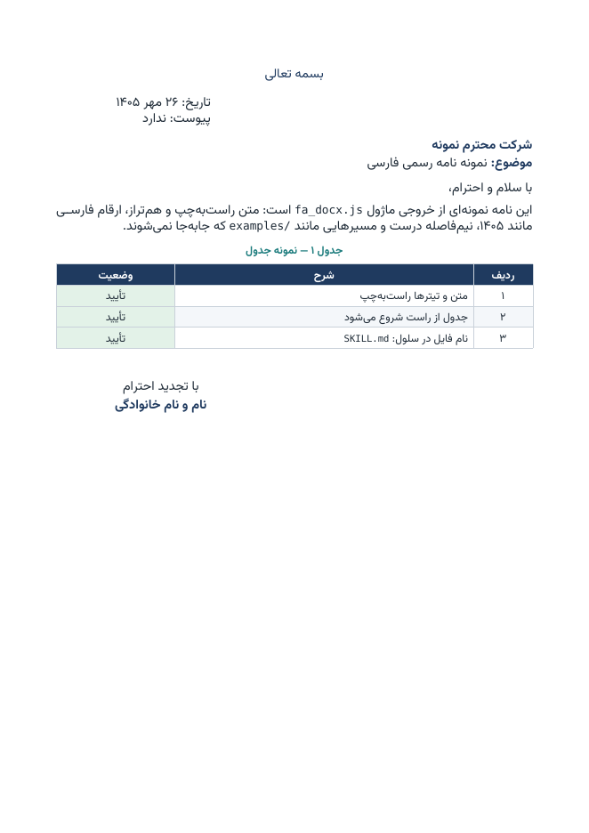
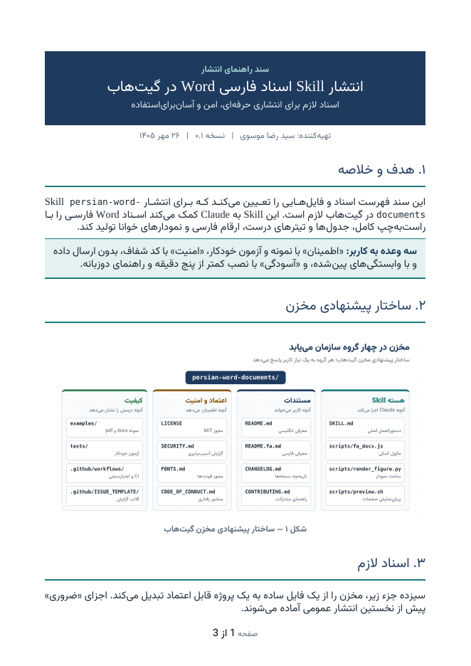
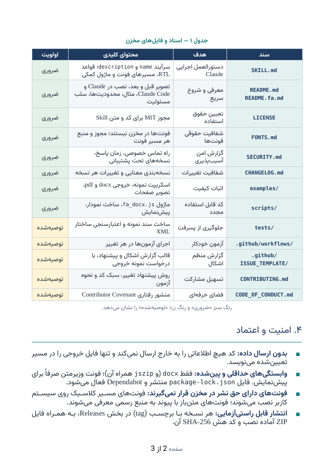
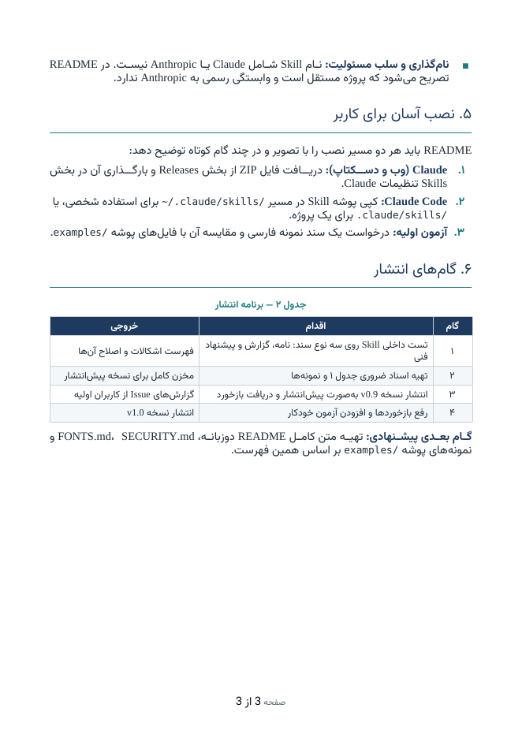
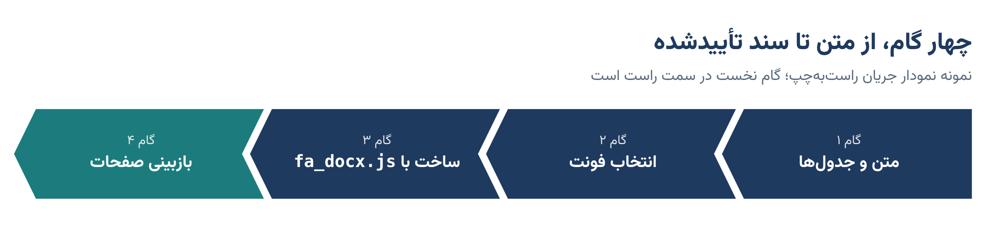

# persian-word-documents

**A skill that helps Claude produce correct right-to-left Persian (Farsi) Word documents.**

[](LICENSE)
[](CHANGELOG.md)
[](https://github.com/srmoosavi/persian-word-documents/actions/workflows/ci.yml)

[فارسی](README.fa.md) · [Security](SECURITY.md) · [Fonts](FONTS.md) · [Changelog](CHANGELOG.md) · [Contributing](CONTRIBUTING.md)

---

Persian documents generated by tools often come out subtly broken: left-aligned headings, tables that start from the left, Latin digits, stretched words in table cells, file paths printed backwards. This skill gives Claude a tested set of rules and a small helper module so that Persian `.docx` files come out right the first time — proposals, reports, formal letters, contracts and manuals.

## Sample output

| Formal letter | Release guide (page 1) | Release guide (page 2) | Release guide (page 3) |
|---|---|---|---|
|  |  |  |  |

Figures are rendered from right-to-left HTML ([`examples/figure-template.html`](examples/figure-template.html)) with `scripts/render_figure.py`:



Source for both lives in [`examples/`](examples/). Previews are rendered with LibreOffice and a substitute font; in Word with the real fonts the pages look the same with slightly different line breaks.

## What it handles

| Area | Behaviour |
|---|---|
| Direction | Every paragraph, run, table and section is marked right-to-left |
| Alignment | Body justified; headings justified or centred; never ambiguous left/right alignment |
| Tables | Columns start on the right; text cells right-aligned without word stretching; header rows repeat across pages |
| Numbers and text | Persian digits, Persian ی/ک, correct ZWNJ (نیم‌فاصله), Persian punctuation, Shamsi dates |
| Mixed scripts | File names, paths and code stay in the right order inside Persian text |
| Lists | Bullets on the right; numbered items keep Persian digits |
| Letters | بسمه تعالی، date and signature blocks on the left, formal salutations |
| Figures | Diagrams, roadmaps and Gantt charts rendered from RTL HTML with correct Persian shaping |
| Fonts | Four documented font paths; no font is hard-coded or bundled (see [FONTS.md](FONTS.md)) |
| Checking | A preview step renders every page so problems are caught before delivery |

## Install

### Claude apps (web and desktop)

Requirements: code execution enabled — *Settings › Capabilities › Code execution and file creation* (Free, Pro, Max). On Team and Enterprise plans an owner enables skills for the organization.

1. Download `persian-word-documents.zip` from the [latest release](https://github.com/srmoosavi/persian-word-documents/releases).
2. In Claude, open **Customize › Skills**, click **+**, choose **Create skill › Upload a skill**, and select the ZIP.
3. Make sure the skill is switched on.

Reference: [Use skills in Claude](https://support.claude.com/en/articles/12512180-use-skills-in-claude).

### Claude Code

```bash
# personal (all projects on this machine)
git clone https://github.com/srmoosavi/persian-word-documents.git ~/.claude/skills/persian-word-documents

# or per project (shared with your team through the repository)
git clone https://github.com/srmoosavi/persian-word-documents.git .claude/skills/persian-word-documents
```

Reference: [Extend Claude with skills](https://code.claude.com/docs/en/skills).

### Check that it works

Ask Claude for a short Persian document, for example:

> یک نامه رسمی یک‌صفحه‌ای فارسی در قالب Word بنویس که یک جدول سه‌ردیفی و نام فایل `report.docx` در متن داشته باشد.

Compare the result with [`docs/images/sample-letter.png`](docs/images/sample-letter.png): text and table start on the right, digits are Persian, and `report.docx` is not reversed.

## Choosing fonts

The skill never forces a font. It picks one of four paths from your stated preference, or asks:

| Path | Use when | Examples |
|---|---|---|
| A — Classic Iranian official | Recipients use Iranian Windows setups; official correspondence | B Nazanin, B Lotus, B Titr |
| B — Modern open-source | Modern look; files shared widely | Vazirmatn, Sahel, Samim, Estedad |
| C — System-safe | Recipient's fonts unknown | Tahoma, Arial, Times New Roman |
| D — Office-native | Microsoft 365 users | Segoe UI, Calibri |

Licensing notes for each path are in [FONTS.md](FONTS.md).

## Repository layout

```
persian-word-documents/
├── SKILL.md                  instructions Claude follows (the skill itself)
├── scripts/
│   ├── fa_docx.js            RTL helper module for docx-js
│   ├── render_figure.py      RTL HTML figure → PNG (Playwright)
│   └── preview.sh            .docx → PDF + page images for checking
├── examples/                 minimal letter, 3-page guide, figure template
├── tests/                    structural tests for the helper module
├── docs/images/              preview images used in this README
└── .github/                  CI, issue and pull request templates
```

## Using the helper module directly

The module also works without Claude:

```bash
npm ci
npm run example     # writes examples/minimal-letter.docx
npm test            # 9 structural checks (RTL sections, alignment, LTR paths, Persian digits …)
```

Tested with `docx` 9.7.1 (the version available in Claude's sandbox) and 9.11.0.

```js
const h = require("./scripts/fa_docx");
const d = require("docx");
const doc = new d.Document({ ...h.docDefaults(), sections: [{ properties: { page: h.page }, children: [
  h.H1("۱. خلاصه"),
  h.P("متن **پررنگ** و مسیر `docs/images/` بدون جابه‌جایی."),
  h.table(["ستون ۱", "ستون ۲"], [["الف", "ب"]], [4819, 4819]),
] }] });
h.save(doc, "out.docx");
```

## Security and privacy

- The skill and its scripts make **no network requests while building documents** and send no document content anywhere.
- Dependencies are minimal and pinned: `docx` (with its bundled `jszip`). Optional tools: Playwright for figures, LibreOffice and the `vazirmatn` npm package for previews.
- `scripts/preview.sh` changes only font-preview settings in your home directory and says exactly what it changes.
- Like any skill, this one tells Claude to run code. Read `SKILL.md` and `scripts/` before installing; they are short and plain.

See [SECURITY.md](SECURITY.md) for supported versions and how to report a vulnerability privately.

## Known limitations

- Page breaks in Word differ slightly from the preview, which uses a substitute font.
- Documents with a table of contents ask to update fields when first opened in Word — answer **Yes**.
- Word list numbering can show Latin digits, so the skill writes numbered items manually.
- Fonts from paths A and B must be installed on the reader's machine, or embedded in the file from Word (*File › Options › Save › Embed fonts in the file*).

## Contributing

Bug reports with a sample `.docx` and a screenshot from Word are the most useful contribution. See [CONTRIBUTING.md](CONTRIBUTING.md). Issues are welcome in Persian or English.

## License and disclaimer

[MIT](LICENSE) © 2026 Seyed Reza Moosavi.

This is an independent community project. It is not made, endorsed or supported by Anthropic. "Claude" is a trademark of Anthropic, PBC; it is used here only to describe compatibility.
